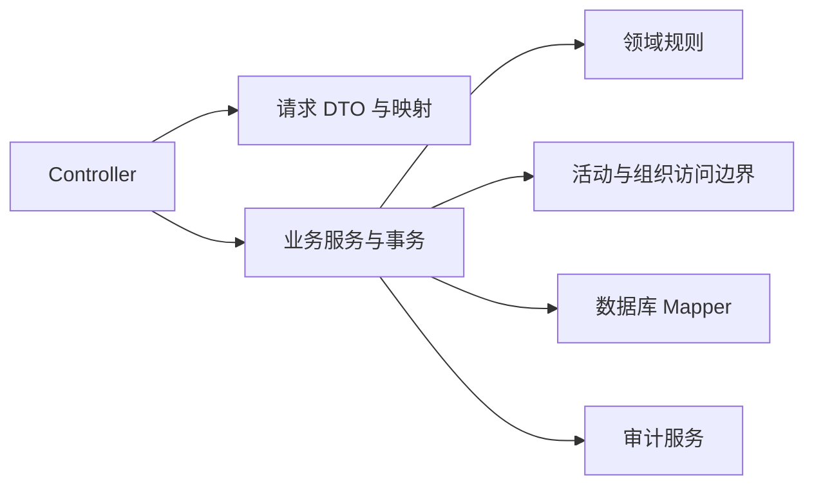

# 架构与维护约定

当前采用按业务模块组织的单体服务。保持 Spring Boot + MyBatis-Plus，不为目录数量拆微服务。

| 职责 | 代码位置 | 修改约定 |
| --- | --- | --- |
| HTTP 接入 | `module/*/controller` | 接收请求、参数校验、返回响应；不直接修改组织或审批数据库 |
| 活动输入 | `module/activity/dto` | `ActivitySaveRequest` 明确可写字段；保留日期兼容；映射不决定业务状态 |
| 规则 | `module/activity/domain` | `ActivityRules` 校验活动；`ApprovalPolicy` 管理提交、发布和审批条件；不访问 HTTP 或数据库 |
| 业务编排 | `module/*/service` | 事务边界、锁顺序、持久化及审计；必须通过 Spring 注入调用 |
| 权限边界 | `security/OrganizationAccess`、`ActivityAccess` | 服务层验证组织归属；拦截器继续作为 HTTP 第一层校验 |
| SQL | `module/*/mapper` | 分页、行锁和批量更新；禁止从数据库旧快照回写整行状态 |
| 审计 | `system/service/AuditService` | 写操作加入调用者事务；业务模块无需依赖登录与账号管理服务来写日志 |

## 事务和并发

- 创建、修改、取消、发布、提交审核、审批和组织状态更新由业务服务开启事务，控制器不承担事务。
- 活动写操作先锁活动，再锁审批单，避免不同流程锁顺序相反。
- `ActivityAccess.lock` 使用 `MANDATORY` 传播级别，无现有事务时直接失败，防止读取后锁立即释放。
- 组织状态和审核策略采用按列更新，避免两个并发请求互相覆盖不相关字段。
- 组织停用与旧令牌撤销同一事务提交；审核状态与对应审计记录同一事务提交。
- 查询页批量读取组织审核策略，避免每条活动再查一次组织。

## 题目二编辑约定

活动在所有生命周期状态均可编辑、删除。编辑保留组织归属、宣传链接、报名和签到记录，更新状态以匹配修改后的时间。待审内容修改时撤销旧申请，审批快照保持不变；已发布活动允许直接修改，不要求重新创建。版本冲突、权限隔离及输入校验仍有效。

## 接口兼容

- 接口 URL、响应包裹和已有日期格式保持兼容。
- 活动 DTO 不接受外部设置 `status`、`signedCount`、`approvalStatus`、`createdBy` 等受控元数据。
- 附件为 null 或省略：更新时保持附件；空数组：明确清空；数组中 null 项拒绝。
- 数字 ID 和计数不允许小数截断。严格文本反序列化限定于活动 DTO，保留旧签到接口数字 ID 到字符串参数的兼容。
- 后续将报名、签到、账号剩余 Map 请求迁移到 DTO 时，先增加兼容测试再替换，不能直接全局禁止字符串转换。

## 验证入口

- `mvn -f backend/pom.xml test`：纯规则、请求解析、服务权限及事务保护单元测试，无需 MySQL。
- `mvn -f backend/pom.xml package`：后端打包，默认运行上述测试。
- `npm --prefix frontend ci`、`npm --prefix frontend run build`：前端安装与构建。
- 后端启动、测试库准备后，运行 `node docs/testing/verify.mjs`、`platform.mjs`、`review.mjs`、`structure.mjs` 和 `round3.mjs`。除第一个脚本外，路径均加 `docs/testing/` 前缀。
- 接口测试会创建测试记录和审计记录，应使用测试数据库；不要把本机回归解释为生产容量验证。
- `.github/workflows/ci.yml` 提供 Java 17 单元测试与前端构建工作流；上传 GitHub 后才会触发远端 CI，本地没有远端执行记录。

## 前端维护

公共颜色、间距与控件样式集中在 `styles/main.css`；导航框架在 `layout/AdminLayout.vue`，线性图标在 `components/AppIcon.vue`。页面保留业务布局样式，避免复制品牌色和公共控件定义。工作台只使用真实接口数据，不填充演示数字。

## 仍需继续处理

这次完成活动、审批、组织与审计相关结构整理，账号、报名和签到仍有历史 Map 请求和可继续拆分的服务。统一认证、通知、场地预约、对象存储、分布式限流、数据库版本管理与生产监控尚未完成。审批历史仍未保存完整内容快照，不能宣称合规防篡改。生产部署仍需独立密钥、备份恢复演练、真实容量和多实例验收。
