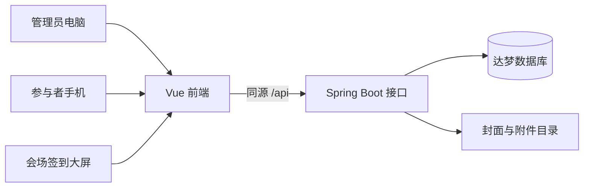

# 高校学生活动全流程管理系统详细实现路线与前后端协作方案

编制日期：2026年10月18日。

本方案用于第二题的开发规划。目标是在约八周内完成题目基本要求及所有明确列出的可选项，形成界面精美、切换流畅、业务完整、能够现场演示的系统。你负责 Java 后端，AI 负责前端，双方按照同一份接口契约开发。本次交付为实施方案，尚未实现或验证系统功能。

需求依据：[实训题目及要求（2026 ）](<D:/download/实训题目及要求（2026 ）.docx>)。下文将题目要求与自行补充的设计分开说明。覆盖加分项是开发目标，具体分值以教师评分为准。

## 1 技术方案与最终产品形态

采用前后端分离的 Web 系统，包含三个使用场景：

- 管理员在电脑上创建活动、发布宣传页、管理报名和签到。
- 参与者在手机上通过链接或二维码查看活动、报名和签到，无需注册。
- 会场电脑或投影设备打开签到大屏，展示每30秒更新的动态二维码。

### 1.1 技术选型

| 层次 | 建议方案 | 选择原因与落地方式 |
|---|---|---|
| 前端 | Vue 3、TypeScript、Vite | 组件化组织页面，利用类型检查减少 AI 生成代码中的字段错误 |
| 页面路由 | Vue Router | 管理后台与公共页面分组，实现局部页面切换 |
| 前端状态 | Pinia | 保存管理员身份、必要的跨页状态；筛选条件优先进入 URL |
| 后台组件 | Element Plus | 使用表单、表格、日期选择器、弹窗等组件，并统一定制主题 |
| 公共页面 | Vue 自定义组件、CSS 变量 | 活动宣传、报名和签到页面单独设计，适配手机 |
| 网络请求 | Axios，统一 API 模块 | 统一处理错误、超时、登录失效和请求取消 |
| 二维码 | 成熟的本地二维码编码库 | 将后端返回的链接编码为二维码，避免调用外部二维码服务 |
| 后端 | JDK 21、Spring Boot、Maven | 你编写 REST 接口、业务规则与数据库访问 |
| 身份认证 | Spring Security、服务端 Session | 管理员通过会话认证；同源部署便于处理 Cookie |
| 数据访问 | MyBatis、达梦 JDBC | SQL 和事务规则明确，方便检查范式和并发行为 |
| 数据库 | 达梦 DM8 | 从第一周开始实际存储活动、报名、签到等业务数据 |
| 文件存储 | 服务端独立文件目录，数据库记录元数据 | 适合课程项目，便于打包迁移和备份 |
| 正式部署 | Nginx 托管前端，反向代理 `/api` 到 Spring Boot | 前端和接口同域，支持手机扫码和页面直接刷新 |

具体版本在第一周做兼容性验证后固定到构建文件和锁文件。Spring Boot 与 MyBatis Starter 必须选匹配组合，例如官方列出的 Boot 4.0 与 Starter 4.0 组合。不能让 AI 分别选择互不兼容的版本。[MyBatis 官方兼容说明](https://mybatis.org/spring-boot-starter/mybatis-spring-boot-autoconfigure/)

Java、Maven、Node.js 的版本写入 README。Node.js 必须满足所选 Vite 的要求，并固定前端依赖锁文件。[Vite 环境要求](https://vite.dev/guide/)、[Spring Boot 环境要求](https://docs.spring.io/spring-boot/system-requirements.html)

### 1.2 数据流



公开报名页可以匿名访问，后台接口必须鉴权。活动状态、剩余名额、二维码有效性均由后端判定。

## 2 题目要求与可选项覆盖清单

| 性质 | 要求 | 实现方式 | 验收证据 |
|---|---|---|---|
| 基本 | 管理员登录 | 登录、当前身份查询、退出、会话超时处理 | 匿名访问后台接口被拒绝 |
| 基本 | 活动创建 | 名称、类型、简介、起止时间、地点、报名截止时间、人数上限 | 表单保存后可从达梦查询到记录 |
| 基本 | 活动查询 | 分页列表，显示状态、发布时间、报名人数 | 准备四种状态的活动进行展示 |
| 基本 | 活动发布 | 发布操作生成可分享的宣传页面链接 | 手机访问该链接看到活动信息 |
| 基本 | 报名二维码 | 宣传页包含直达报名页的二维码 | 手机扫码后进入正确活动的报名页 |
| 基本 | 任意状态编辑和删除 | 不按展示状态限制编辑或删除；校验修改后的数据合法性 | 分别操作未发布、报名中、已截止、已结束活动 |
| 基本 | 编辑后保留报名 | 编辑原活动记录，活动 ID 不变 | 修改后原报名记录及人数仍在 |
| 基本 | 无需注册报名 | 姓名、手机号、学院表单 | 使用无登录状态的手机完成报名 |
| 基本 | 报名校验 | 失效、格式、重复、容量校验 | 正常及各失败场景都有清晰反馈 |
| 可选 | 直播链接 | 创建和编辑时填写；公开页面展示外部链接入口 | 手机可打开配置的链接 |
| 可选 | 活动附件 | 上传、列表、下载、删除附件 | 文件下载后内容正常 |
| 可选 | 多条件查询 | 类型、状态、时间范围可组合筛选 | 同时使用三个条件得到正确结果 |
| 可选 | 宣传与报名时效 | 宣传页明确有效期；报名页面及接口按时失效 | 使用截止活动的旧链接也无法报名 |
| 可选 | 基本签到 | 静态签到码与手机号，核验报名记录 | 已报名者签到成功，重复签到不新增记录 |
| 加分 | 准确签到 | 动态签到码每30秒更新，后端验签并校验时效 | 当前码有效，过期码与篡改码失败 |
| 可选 | 国产数据库 | DM8 实际承担业务持久化 | 配置、表结构、查询结果与重启后数据均可展示 |
| 通用 | 图形界面 | 管理后台、手机端、签到大屏 | 浏览器实际操作验收 |
| 通用 | 至少第三范式 | 实体拆分、外键、唯一约束与设计说明 | ER 图、建表 SQL 与范式说明 |
| 通用 | 报告与演示 | 报告不少于20页，配套源码、测试记录、演示脚本 | 按要求打包提交 |

题目中的准确签到是“定位或者动态二维码”。本方案以动态二维码覆盖该加分要求；定位列为额外增强，不能把两种方式算成两个已明确承诺的加分点。

## 3 前后端分工与协作方式

### 3.1 你负责的后端工作

1. 数据模型、DM8 建表脚本、索引和测试数据。
2. 管理员认证、接口权限、参数校验和统一异常处理。
3. 活动管理、发布、状态计算、筛选和分页。
4. 报名事务、重复报名约束、容量控制。
5. 附件上传下载和公开访问规则。
6. 签到会话、动态码签发、验签、过期校验和签到事务。
7. 接口文档、关键业务测试、部署配置和数据备份。

### 3.2 AI 负责的前端工作

1. 设计规范、布局、组件、响应式页面。
2. 页面路由、统一转场和表单交互。
3. 按接口文档创建 TypeScript 类型、API 模块和模拟数据。
4. 登录、列表、编辑、宣传、报名、签到等页面实现。
5. 加载、空数据、错误、成功、超时等状态。
6. 接入真实接口、修复样式和交互问题。

前端 AI 的修改范围默认限制在 `frontend/`。接口字段、状态枚举或业务规则有变动，先更新契约，再修改两端。不能由页面自行猜测新的接口。

### 3.3 每个功能的固定交付顺序

```text
写接口契约和示例
    → AI 用模拟接口完成页面
    → 你实现后端接口及关键测试
    → 切换真实接口联调
    → 实际验收正常与失败场景
    → 保存截图和测试记录
```

建议维护五份协作文档：`需求与验收.md`、`接口约定.yaml`、`前端设计规范.md`、`联调问题.md`、`演示步骤.md`。接口约定采用 OpenAPI 格式，可使用编辑器或工具检查其结构；是否接入自动生成工具不影响先手写契约。

每次只交付一个完整功能，例如“创建活动并在列表看到结果”。模拟数据由 API 适配层提供，页面组件不直接引用模拟数据；切换真实接口时只调整适配层和运行配置。

## 4 页面清单与布局设计

### 4.1 管理后台

| 页面 | 路径建议 | 主要内容与交互 |
|---|---|---|
| 登录 | `/admin/login` | 品牌区、账号密码、登录状态、错误提示 |
| 工作台 | `/admin/dashboard` | 活动、报名、签到概览，近期活动，快捷入口 |
| 活动列表 | `/admin/activities` | 组合筛选、分页、状态标签、发布及编辑入口 |
| 创建活动 | `/admin/activities/new` | 分步表单、封面、直播链接、附件、预览 |
| 编辑活动 | `/admin/activities/:id/edit` | 回填信息、已有报名数量提醒、未保存离开提示 |
| 活动详情 | `/admin/activities/:id` | 基本信息、宣传发布、报名名单、签到管理四个标签页 |
| 签到大屏 | `/admin/activities/:id/screen` | 活动名、动态二维码、倒计时、已签到人数 |

详情页的标签可通过 URL 参数保留，例如 `?tab=registrations`。筛选、分页和排序也进入 URL，返回列表后恢复位置和条件。

### 4.2 参与者页面

| 页面 | 路径建议 | 主要内容与交互 |
|---|---|---|
| 宣传页 | `/events/:id` | 封面、主题、时间地点、简介、剩余名额、报名二维码、报名按钮 |
| 报名页 | `/events/:id/register` | 活动摘要、姓名、手机号、学院、报名规则和提交 |
| 报名结果 | 报名成功后的页面内结果状态 | 清晰成功反馈、活动时间地点、返回活动入口 |
| 签到页 | `/checkin/:sessionId?token=...` | 活动名称、码有效性、手机号、签到按钮、剩余时间 |
| 无效状态 | 对应活动或签到页面的状态视图 | 未开放、已截止、已结束、已删除、码过期等明确提示 |
| 通用错误页 | `/404` 与异常视图 | 友好提示、重试或返回入口 |

报名、签到结果通过提交响应直接展示，页面刷新后不把手机号或个人信息放入 URL。若需要跨刷新保留结果，应增加独立的随机访问凭证，而不是用手机号作为公开查询凭证。

## 5 精美界面的具体实现标准

### 5.1 视觉方向

采用现代校园活动平台风格：深蓝品牌色、浅灰背景、白色内容卡片、克制的青绿色点缀。管理员端强调清晰高效；参与者端强调活动吸引力和报名便利；三端共享字体、颜色、圆角和图标规范。

先让 AI 交付“活动列表”和“手机宣传页”两个代表性页面，确认设计后再扩展其余页面，避免每个页面各自生成一套视觉风格。

### 5.2 统一设计参数

| 项目 | 建议规格 |
|---|---|
| 品牌主色 | `#1D4ED8`，按钮悬停和按下态使用对应深浅色阶 |
| 页面背景 | `#F5F7FB` |
| 卡片背景 | `#FFFFFF` |
| 主文字 | `#172033` |
| 次级文字 | `#64748B`，小字需检查对比度 |
| 边框 | `#E2E8F0` |
| 成功、提醒、错误 | 分别使用绿色、橙色、红色，并配合文字与图标 |
| 间距体系 | 4、8、12、16、24、32、48px |
| 卡片圆角 | 16px；弹窗20px；输入框和按钮10至12px |
| 正文 | 14至16px；手机输入框文字建议16px |
| 页面标题 | 后台24至28px；宣传页按屏幕宽度24至40px |
| 控件高度 | 后台40至44px；手机主要按钮48px |
| 文字字体 | 优先系统中文字体栈，减少外部字体加载依赖 |
| 图标 | 使用同一套 SVG 图标，尺寸及线宽统一 |

把参数定义为 CSS 变量，并映射到 Element Plus 的主题变量。表格、表单可以使用组件库，页面头部、卡片、空状态、宣传页面按统一规范定制。组件库强调一致性和操作反馈，可作为交互设计的基础。[Element Plus 设计原则](https://element-plus.org/en-US/guide/design.html)

### 5.3 后台布局

- 左侧导航约224px，顶部栏约64px，主要内容区边距24至32px。
- 导航栏和顶部栏在后台页面切换时保持稳定，仅替换内容区域。
- 活动列表顶部为标题和“创建活动”按钮，下方为筛选区，再下方为数据区。
- 表格行保持适度留白；名称、状态、时间、报名人数优先展示。
- 操作过多时收进“更多”，删除操作有清晰确认。
- 活动编辑采用“基本信息—时间与名额—宣传与附件—检查并保存”步骤；已填写数据在步骤切换时保留。
- 工作台统计与图表属于补充体验，必须来自真实接口；表格和文字要能表达同样的信息。

### 5.4 手机页面布局

- 在360、390、430px宽度验收，页面无横向滚动。
- 宣传页依次展示活动封面、类型、主题、关键信息卡、活动介绍、附件和报名区域。
- 桌面端可双栏，手机端单栏；手机固定底部报名按钮，内容预留底部空间和安全区。
- 名额已满、已截止时保留活动信息和明确状态，按钮显示对应原因。
- 报名表使用姓名、手机号和学院三个主要字段，学院可搜索选择。
- 输入错误显示在字段旁，提交错误显示在表单附近；用户不需要反复寻找提示。
- 手机已在宣传页时可直接点击报名，二维码同时保留以满足宣传转发场景。
- 封面尺寸固定，图片按比例裁剪，避免加载后把按钮或文字推走。

## 6 页面切换与流畅体验

### 6.1 动效规范

| 场景 | 动画方案 | 建议时长 |
|---|---|---|
| 后台一级页面切换 | 内容透明度渐变，并向上移动6至10px | 进入约180ms，退出约100ms |
| 手机进入报名页 | 轻微横向滑入，返回时反向 | 200至240ms |
| 标签页切换 | 指示条平移，内容轻淡入 | 140至180ms |
| 弹窗打开 | 遮罩淡入，内容由0.98缩放至1 | 160至200ms |
| 抽屉打开 | 从屏幕边缘滑入 | 200至240ms |
| 卡片反馈 | 边框或阴影变化，小幅位移 | 120至160ms |
| 提交按钮 | 保持尺寸，展示加载状态并防重复点击 | 请求期间 |
| 成功反馈 | 勾选图标短动画，随后展示结果内容 | 约240ms |
| 骨架屏 | 轻微明暗变化，减少大面积闪动 | 加载期间 |

这些数值是本项目的设计目标，需要用实际手机调试。页面转场总等待应控制在约300ms以内，不额外等待接口请求结束才开始展示页面结构。

### 6.2 实现方式

1. 在后台主布局的内容区，用 `RouterView` 插槽包裹统一的 `Transition`；导航栏不参与转场。
2. 每条路由声明页面标题、布局类型和转场类型，手机前进后退使用明确的导航关系判断方向。
3. 路由组件使用合适的 key；默认按路径区分，筛选参数变化不强制销毁整个页面。
4. 列表筛选只更新列表区域；不要每次输入都触发整页淡出淡入。
5. 快速连续点击导航时，只让最后一次导航的页面和请求结果生效。
6. 使用 opacity、transform 做主要动画，避免持续修改宽高、位置和大面积模糊。
7. 列表进入动画只作用于首屏少量内容，延迟总量控制在约120ms；长列表不逐项播放。
8. 页面切换后处理滚动位置和焦点；表单错误聚焦到首个错误字段，弹窗关闭后焦点回到触发按钮。
9. 根据 `prefers-reduced-motion` 关闭位移、缩放等非必要动效，保留清晰状态反馈。

Vue Router 官方提供了路由组件与 Transition 的组合方式，也支持按路由指定转场。[路由转场说明](https://router.vuejs.org/guide/advanced/transitions)、[Vue Transition 说明](https://vuejs.org/guide/built-ins/transition.html)。减少动态效果的偏好通过 CSS 媒体查询处理。[MDN 说明](https://developer.mozilla.org/en-US/docs/Web/CSS/@media/prefers-reduced-motion)

### 6.3 数据加载与性能

- 路由按页面拆包，签到和宣传页面尽量少加载后台表格等依赖。
- 慢请求展示骨架屏；非常短的请求可延迟约150ms再显示加载反馈，避免闪烁。
- 搜索输入采用约300ms防抖；旧请求取消，或使用请求序号忽略过时响应。
- 类型和学院字典可缓存；涉及名额、截止时间、签到有效性的判断每次提交都由后端复核。
- 图片压缩并使用适当尺寸，普通宣传封面目标控制在约300KB内。
- 活动简介限制内容复杂度；若使用富文本，必须配套可靠的清洗规则。
- 接口失败保留用户已填信息，提供重试；失败时不能显示成功动画。
- 签到大屏倒计时仅更新计时控件，不每秒重新请求整个活动或重绘全部页面。
- 大屏离开页面后释放定时器和请求；恢复可见时重新与服务器时间同步。

## 7 后端模块与代码组织

建议使用单体分层架构，按业务模块组织，避免过早增加服务拆分和运维组件。

```text
backend/
  src/main/java/.../
    auth/           管理员认证与当前身份
    activity/       活动编辑、发布、状态与筛选
    registration/   报名规则与事务
    checkin/        签到会话、动态码与签到记录
    attachment/     封面及附件上传下载
    dictionary/     学院与活动类型
    dashboard/      基础统计
    common/         响应、异常、时间、参数校验
    config/         安全、MyBatis、文件目录
  src/main/resources/
    mapper/
    application.yml
    db/
      schema-dm.sql
      seed-demo.sql
```

每个业务模块包含 Controller、Service、Mapper，以及请求和响应 DTO。Controller 接收及校验数据；Service 执行业务规则和事务；Mapper 专注 SQL。数据库实体不直接作为公开 API 返回。

外部数据统一做服务端校验，使用参数绑定执行 SQL；日志记录请求标识和错误原因，避免直接打印完整手机号、密码、会话凭证或动态码密钥。

## 8 数据库设计与第三范式

### 8.1 核心表

| 表名建议 | 核心字段 | 约束和作用 |
|---|---|---|
| `ADMIN_ACCOUNT` | id、username、password_hash、enabled、created_at | username 唯一，存管理员账号 |
| `ACTIVITY_TYPE` | id、name、sort_order、enabled | 活动类型字典 |
| `COLLEGE` | id、name、sort_order、enabled | 学院字典 |
| `ACTIVITY` | id、type_id、name、description、location、start_at、end_at、registration_deadline、capacity、publication_state、published_at、live_url、cover_path、created_by、version、deleted_at | 活动基本信息，类型和创建者外键 |
| `REGISTRATION` | id、activity_id、name、phone、college_id、created_at | `(activity_id, phone)` 唯一；活动和学院外键 |
| `ATTACHMENT` | id、activity_id、original_name、storage_key、content_type、size_bytes、created_at | 一条记录对应一个附件，activity_id 外键 |
| `CHECKIN_SESSION` | id、activity_id、mode、window_start、window_end、token_version、enabled、created_at | 管理该活动签到方式、时段和码撤销版本 |
| `CHECKIN_RECORD` | registration_id、session_id、checked_at | registration_id 为主键兼外键，保证一份报名最多签到一次；签到方式从会话关联查询 |

ID 建议统一使用 Java 生成的 UUID，接口以字符串传输。手机号按字符串存储。所有表名和字段名先在 DM8 上验证，避免保留字冲突。

### 8.2 范式说明

- 学院名称只存储在学院表，报名记录引用学院 ID。
- 活动类型名称只存储在类型表，活动引用类型 ID。
- 报名记录不重复保存活动名称、时间、地点。
- 签到记录不重复保存姓名、手机号、学院，关联报名记录查询。
- 签到方式只保存在签到会话中，签到记录不重复保存可由会话决定的方式字段。
- 附件独立成表，不在活动字段里保存逗号分隔的附件列表。
- 不把同一手机号的不同活动报名强行合并成“注册学生账号”；报名信息属于当次活动报名。
- 已报名人数通过报名表计数，展示状态通过活动字段与服务器时间计算，初版不维护两套可能不同步的冗余数据。

最终以实际字段的函数依赖检查第三范式：非主属性依赖键，并且不通过其他非主属性传递依赖。ER 图和说明必须与最终 SQL 保持一致。

### 8.3 索引与持久化

为报名的活动外键、活动类型和时间筛选、附件所属活动、签到会话所属活动建立必要索引。唯一约束以数据库为准，服务端预检查只用于提供友好提示。

文件内容存独立目录，文件元数据存数据库。备份必须同时包含数据库和上传目录；重启应用不能清空业务表或上传文件。达梦 JDBC 驱动要与服务端版本匹配，并尽早在实际 JDK 上验证连接、中文、事务、分页、时间字段。[达梦 Java 连接文档](https://eco.dameng.com/document/dm/zh-cn/start/JAVA_NEW.html)

## 9 活动生命周期与编辑规则

### 9.1 展示状态统一计算

数据库保存发布状态 `DRAFT` 或 `PUBLISHED`，页面展示状态由后端根据服务器时间按以下优先级计算：

1. 已删除：公共访问返回活动已失效，不进入普通列表。
2. 未发布：`publication_state = DRAFT`。
3. 已结束：已发布且当前时间不早于活动结束时间。
4. 已截止：已发布、未结束且当前时间不早于报名截止时间。
5. 报名中：已发布且尚未到报名截止时间。

名额已满作为单独的报名可用性原因展示，不额外改变题目规定的四种主要状态。建议接口同时返回 `displayStatus`、`canRegister`、`unavailableReason`。

状态筛选必须在数据库查询与分页前使用相同规则处理，不能先分页再在 Java 或前端过滤，否则总数和页面内容会错。

### 9.2 时间与容量规则

- 活动开始时间早于结束时间，报名截止时间不晚于开始时间。
- 保存草稿允许过去日期，便于记录历史活动；发布后的报名可用性由实际时间判断。
- 人数上限是正整数；修改容量时不能小于已有报名人数。
- 修改已结束活动的时间后，按照新时间重新计算展示状态，并在提交前提示影响。
- 所有时间边界采用后端时间。接口使用带时区的 ISO 8601，前端按 `Asia/Shanghai` 展示。
- 数据库时间统一采用 UTC 约定；Java 显式转换，禁止一部分字段存本地时间、一部分存 UTC。

### 9.3 任意状态编辑、删除和重新宣传

活动编辑更新原记录，不删除再创建。发布时间与报名记录保留；已发布活动编辑后仍然为已发布，更新宣传页即可看到新信息。宣传和报名地址保持稳定，重新生成二维码仍指向同一活动。

用 version 字段进行乐观锁更新，避免两个管理员同时编辑时悄悄覆盖对方的修改。若同时调整名额，必须与报名使用同一活动行锁或等价机制，确保校验与写入之间没有并发空隙。

删除采用逻辑删除，各状态都允许操作。删除后隐藏公开页面、禁止报名签到及公开附件下载，保留历史数据以便解释和排查。删除与报名、签到同样在活动锁下协调。

若编辑改变签到时间或地点，撤销原签到会话并提示管理员重新开启，使旧二维码不能按旧条件继续签到。对“任何状态可编辑”的支持不等于接受非法时间和容量。

## 10 报名的具体实现

### 10.1 信息校验

- 姓名去除首尾空格，允许合理长度的中文、英文及姓名中的连接符，不强制只能是汉字。
- 本项目按中国大陆手机号设计：去除首尾空格后采用11位格式校验；同一活动以规范化手机号判断重复报名。
- 学院使用有效的学院 ID；前端选择器展示学院名称。
- 不能仅靠按钮置灰判断截止或名额，必须允许后端返回实时业务错误。

“同一人”按手机号识别是基于题目字段作出的设计假设，写入需求分析；姓名不同但手机号相同也视为重复。

### 10.2 并发下防超额

初版采用“活动行锁 + 事务 + 唯一约束”的方案，便于理解和演示。

```text
收到报名请求
    → 在事务内锁定对应活动记录
    → 检查是否发布、是否删除、截止时间
    → 检查该活动是否已存在该手机号
    → 统计该活动报名人数并比较容量
    → 插入报名记录
    → 提交事务
```

同一活动的报名请求串行通过该锁，数据库唯一约束负责最后兜底。所有能影响名额或有效性的写入也必须遵守同一锁约定。锁定查询语法和隔离行为须在 DM8 实测。

遇到唯一约束冲突时转换为“请勿重复报名”；死锁或锁等待超时转换为可重试错误，不能把底层 SQL 错误直接显示给用户。

验收必须包含“只剩1个名额，多个不同手机号同时提交，最终仅1人成功”。前端防抖和按钮禁用只改善体验，不能替代事务。

## 11 宣传页、二维码、直播和附件

### 11.1 宣传页生成

管理员发布后，后端返回宣传 URL 和报名 URL。前端用统一宣传模板渲染活动信息，并把报名 URL 编码为二维码。这里的“生成”可以是数据库活动信息驱动的网页，不必为每个活动复制一份静态 HTML。

宣传页具备活动名称、类型、介绍、起止时间、地点、截止时间、报名入口和报名二维码。封面、直播入口及附件属于扩展信息。

活动信息编辑后，页面重新读取最新数据，旧宣传链接仍能展示新内容，已有报名不受影响。若另外导出静态海报图片，应写明生成时间；静态图片无法自动更新。

### 11.2 时效规则

本方案把“报名时段”定义为活动发布至报名截止。发布响应明确返回 `validFrom`、`validUntil`，宣传页展示有效期；到期后切换为“宣传报名链接已失效”的状态视图，保留活动时间地点摘要帮助辨认，关闭报名入口。报名页同样展示失效原因，后端拒绝报名；已删除活动返回活动失效视图。

报名二维码采用稳定 URL，时效由服务器判定。不要只让二维码在前端消失，因为旧二维码截图和直接调用接口仍可能存在。

### 11.3 直播与附件

直播字段仅接受 HTTP/HTTPS 链接；前端展示“进入直播”，外部页面在新窗口打开。题目要求添加链接，不需要自建直播推流服务。

附件建议允许 PDF、DOCX、PPTX 等明确类型，封面只允许普通图片类型；设置文件大小上限，例如单附件20MB、封面5MB，并在接口和页面共同说明。扩展名、媒体类型与可检查的文件特征应做一致性校验，拒绝脚本和可执行文件。

文件存储名由服务器随机生成；下载通过附件 ID 解析路径，不能接收任意磁盘路径。后台可管理未发布活动附件，公开下载需检查对应活动已发布且未删除。孤立文件由定期清理或人工维护处理。

新建活动时，先在前端暂存待上传文件；基本信息成功保存并取得活动 ID 后再上传封面和附件，上传完成再允许发布。部分文件失败时保留活动草稿、明确列出失败项并允许重试，不能用“创建失败”误导用户重复创建活动。

Spring MVC 支持 multipart 上传；实现时自行配置大小限制和持久目录，上传目录不能在每次启动时删除。[Spring 文件上传指南](https://spring.io/guides/gs/uploading-files/)

## 12 基本签到与动态二维码

### 12.1 签到会话

管理员在活动详情中选择基本或动态模式，设置签到起止时间并开启会话。一个活动同时最多允许一个启用的会话。初始建议允许管理员配置活动开始前30分钟至结束后15分钟，属于本项目补充规则。

启用和关闭会话都由后台鉴权接口操作。动态模式开启后，基本模式入口同时失效，防止使用静态入口绕过动态码要求。

### 12.2 基本签到流程

扫码打开静态签到页，输入手机号，后端检查活动、启用会话、时间范围和报名记录。成功后插入签到记录；重复请求返回“已签到”和原签到时间，不新增记录。

### 12.3 动态码生成与验证

后端生成带签名的挑战凭证，内容至少包含签到会话 ID、活动 ID、会话版本、签发时间、过期时间和随机标识。使用成熟的签名实现，例如 HMAC-SHA256；密钥仅在后端配置，不能写入前端或仓库。

1. 会场大屏通过管理员鉴权接口领取当前挑战凭证。
2. 挑战凭证按服务器30秒时间段生效，大屏根据返回的 `serverTime`、`expiresAt` 安排刷新。
3. 大屏将带凭证的签到 URL 编码为二维码，并显示倒计时。
4. 学生扫码进入签到页，页面验证上下文后允许输入手机号。
5. 提交手机号与原凭证，后端验签，检查签发和过期时间、会话版本、活动归属、启用状态及签到时段。
6. 查找当前活动的报名记录，校验后写入唯一的签到记录。

30秒凭证到期后，仍停留在旧签到页的用户需要重新扫描现场新码，页面明确提示原因。公开页面不能自行领取新动态凭证，否则远程打开一次页面就可以长期绕过现场扫码。

上下文查询只返回活动名称、有效状态和到期时间，不返回新凭证、报名名单或完整手机号。响应及签到大屏相关数据设置适当的禁止缓存策略。

### 12.4 撤销、并发与实际边界

- 关闭签到会话后，即使凭证尚未到期也拒绝签到。
- 修改会话版本能够一次性撤销旧凭证，后端每次签到读取有效会话状态。
- 签到事务按统一顺序锁定活动和会话，避免关闭与签到之间出现竞态。
- 同一活动允许多个参与人使用同一时段的二维码，不能把公共挑战凭证设计成“第一个人用完立即作废”。
- 唯一性限制放在报名记录维度，保证一份报名只能签到一次。
- 动态二维码减少旧截图复用，不能阻止有效期内实时转发，也不能证明手机号由本人持有。答辩中应准确说明能力边界。

### 12.5 定位增强

若第六周动态码和全部必需功能已稳定，可增加位置范围校验：保存活动经纬度和半径，手机提交坐标与定位精度，后端计算距离并判定。位置、精度不足、拒绝授权和定位失败都需要独立反馈。

浏览器定位需要安全上下文及用户授权；手机访问普通局域网 HTTP 地址通常不能满足安全上下文要求，因此应先落实 HTTPS 再排入开发。定位也可能被伪造，不作绝对防作弊承诺。[MDN Geolocation API](https://developer.mozilla.org/en-US/docs/Web/API/Geolocation_API)

## 13 接口契约

### 13.1 通用约定

- 基础路径 `/api/v1`，JSON 字段使用 lowerCamelCase。
- ID 统一为字符串；时间是带时区的 ISO 8601；金额无需求，不增加支付字段。
- 分页从1开始，返回 `items`、`page`、`pageSize`、`total`，限制单页最大条数。
- 普通成功响应包含 `code`、`message`、`data`、`requestId`；文件下载和删除无正文响应单独注明。
- HTTP 状态码与业务码同时使用：参数错误400、未认证401、无权限403、不存在404、重复或版本冲突409。
- 前端通过业务码选择交互，不依赖中文提示文本进行条件判断。
- 活动提交携带 version，后端发现版本冲突返回明确错误，前端保留草稿并提示重新读取。

示例报名接口：

```text
POST /api/v1/public/activities/{activityId}/registrations

请求：{ name, phone, collegeId }
成功数据：{ registrationId, registeredAt, activityName, startAt, location }
可能错误：ACTIVITY_UNAVAILABLE、REGISTRATION_CLOSED、
          REGISTRATION_FULL、REGISTRATION_DUPLICATE、VALIDATION_ERROR
```

### 13.2 最小接口清单

| 分组 | 方法与地址 | 说明 |
|---|---|---|
| 会话 | `GET /auth/csrf` | 获取当前 CSRF 令牌，支持匿名访问 |
| 会话 | `POST /auth/login` | 管理员登录 |
| 会话 | `GET /auth/me` | 查询当前管理员 |
| 会话 | `POST /auth/logout` | 退出并使会话失效 |
| 字典 | `GET /public/activity-types`、`GET /public/colleges` | 类型和学院 |
| 活动 | `GET /admin/activities` | 组合筛选及分页 |
| 活动 | `POST /admin/activities` | 创建活动 |
| 活动 | `GET /admin/activities/{id}` | 管理员详情 |
| 活动 | `PUT /admin/activities/{id}` | 编辑原活动 |
| 活动 | `DELETE /admin/activities/{id}` | 逻辑删除 |
| 发布 | `POST /admin/activities/{id}/publish` | 发布及返回分享地址；重复调用不重复建活动 |
| 宣传 | `GET /public/activities/{id}` | 公开活动信息与报名可用性，不返回报名名单 |
| 报名 | `POST /public/activities/{id}/registrations` | 匿名报名 |
| 名单 | `GET /admin/activities/{id}/registrations` | 分页报名名单及签到状态 |
| 封面 | `POST /admin/activities/{id}/cover` | 上传或替换封面 |
| 封面 | `GET /public/activities/{id}/cover` | 检查活动公开状态后返回封面 |
| 附件 | `POST /admin/activities/{id}/attachments` | 上传附件 |
| 附件 | `GET /admin/attachments/{id}/download` | 后台下载，允许查看草稿附件 |
| 附件 | `GET /public/attachments/{id}/download` | 按活动公开权限下载 |
| 附件 | `DELETE /admin/attachments/{id}` | 删除附件记录及安排文件清理 |
| 签到 | `POST /admin/activities/{id}/checkin-sessions` | 创建及开启签到会话 |
| 签到 | `POST /admin/checkin-sessions/{id}/close` | 关闭会话并撤销码 |
| 动态码 | `GET /admin/checkin-sessions/{id}/challenge` | 仅管理员领取当前挑战凭证 |
| 扫码 | `POST /public/checkin-context` | 校验扫描凭证，返回非敏感上下文 |
| 签到 | `POST /public/checkins` | 提交会话、手机号及凭证，完成基本或动态签到 |
| 统计 | `GET /admin/dashboard` | 概览数据 |
| 大屏 | `GET /admin/activities/{id}/checkin-summary` | 报名及签到汇总，不返回手机号 |

第一周把每个接口的请求、响应、错误码、鉴权、时区、空值和字段长度写完整。此处表格是契约的目录，不替代正式 OpenAPI 文档。

### 13.3 认证与请求保护

使用服务端 Session。正式环境的会话 Cookie 配置 HttpOnly、Secure 和合适的 SameSite；登录后更新会话标识。前端刷新时先查询 `/auth/me`，401时清理身份并跳转登录。

会话认证配套 CSRF 保护：匿名页面也可通过约定接口获取令牌，前端写请求携带相应请求头；登录及退出后重新获取令牌。前端开发使用 Vite 代理，正式环境同域代理，减少跨域配置。不要为联调方便整体关闭写接口保护。[Spring Security CSRF 文档](https://docs.spring.io/spring-security/reference/servlet/exploits/csrf.html)

公开报名和签到仍需要字段校验、合理限流和统一失败处理。限流需要考虑校园网共享出口，不能简单按单个 IP 设置极低阈值。手机号只对有权限的管理员显示，普通日志中脱敏。

## 14 AI 前端开发任务拆分

### 14.1 前端目录建议

```text
frontend/src/
  api/                 请求封装、业务 API、模拟适配
  types/               与后端契约一致的数据类型
  layouts/             后台布局、公开页面布局
  router/              路由、页面元信息、认证守卫
  stores/              管理员会话等共享状态
  styles/              设计变量、全局样式、动效和组件库主题
  components/common/   页面头部、状态标签、空状态、错误状态
  components/activity/ 活动卡片、表单、宣传预览
  components/checkin/  二维码展示、倒计时、结果反馈
  views/admin/         登录、工作台、活动和签到大屏
  views/public/        宣传、报名、签到
```

### 14.2 分批让 AI 实现

| 批次 | 给 AI 的任务 | 本批验收重点 |
|---|---|---|
| 1 | 项目骨架、主题变量、路由和布局 | 可以启动，后台外壳稳定，页面切换正常 |
| 2 | 活动列表与手机宣传页 | 确认视觉方向、尺寸、响应式、状态和动效 |
| 3 | 登录、活动编辑表单与宣传预览 | 输入校验、编辑回填、未保存保护、附件状态 |
| 4 | 报名及报名结果 | 无需登录，重复、满额、截止等错误完整 |
| 5 | 报名名单与签到管理 | 分页、状态、操作反馈和真实数据 |
| 6 | 动态码大屏与手机签到 | 时间同步、过期反馈、会话关闭和定时器清理 |
| 7 | 全量真实接口联调 | 正式配置不再使用模拟成功结果 |
| 8 | 视觉和交互统一修整 | 手机、桌面、弱网、快速切换、构建检查 |

### 14.3 可复用的 AI 任务模板

> 你负责本项目 frontend 目录中的 Vue 3 + TypeScript 前端。先阅读接口约定和前端设计规范，仅实现本次指定功能。接口字段、状态枚举、时间格式和鉴权方式以契约为准；缺失内容先列出，不自行发明接口。遵守统一颜色、间距、组件及转场规范，管理后台只让内容区域参与转场。交付正常、加载、空数据、失败、提交中和成功状态，适配指定桌面及手机尺寸。业务数据从统一 API 层读取，模拟接口与真实接口保持相同协议。不得通过修改后端或放宽业务校验让前端“看起来成功”。完成后运行类型检查与生产构建，记录需要后端提供的接口和实际验收结果。

每次任务附上具体页面、字段、示例响应、错误码、参考页面和本次修改范围。视觉调整要求描述成“间距、层级、色彩、反馈、时长”，不要只说“更高级”“更炫酷”。

## 15 八周实施路线

以下按每周约12至18小时的后端投入、AI 前端并行推进制定。实际投入不同，应调整周内任务，但保留最后两周的联调与交付时间。

| 周次 | 你负责的后端 | AI 负责的前端 | 当周可验收成果 |
|---|---|---|---|
| 第1周 | 安装DM8，验证JDBC；确定表结构与契约；登录、字典、活动创建骨架 | 搭项目、设计变量、后台外壳、两张代表性页面 | 能连接真实数据库，能登录，视觉方向确认，契约可审阅 |
| 第2周 | 活动创建、编辑、删除、发布、详情、状态和组合查询 | 活动列表、分步表单、详情、宣传页与转场 | 四种状态可操作；发布后手机能看到宣传页 |
| 第3周 | 报名事务、唯一约束、容量控制、报名名单；并发测试 | 报名表、结果、失败状态、报名名单 | 手机报名进入DM8；并发不超额；编辑不丢报名 |
| 第4周 | 封面、附件、直播字段、时效控制、公开访问规则 | 上传下载、宣传预览、二维码、截止视图、手机细节 | 所有活动发布和报名相关可选项可演示 |
| 第5周 | 签到会话、基本签到、动态凭证、验签和撤销 | 签到大屏、倒计时、手机签到与结果 | 基本与动态模式均可操作；过期码被拒绝 |
| 第6周 | 补齐权限和异常；关键场景集成测试；必要的统计接口 | 全部接真实接口；统一视觉、响应式、转场和加载体验 | 全流程在正式部署地址跑通；全部明确可选项覆盖 |
| 第7周 | 并发、时间边界、权限、重启恢复和备份测试 | 桌面手机、弱网、快速切换、输入和弹窗验收 | 测试报告、缺陷修复记录、报告初稿完成 |
| 第8周 | 固定版本、恢复演练、源码与配置整理 | 构建发布、演示数据与页面截图 | 完整报告、源码包、部署说明和现场演示脚本 |

第1至3周重点是让一个活动从创建走到报名。第4至6周补齐所有明确可选项和界面细节。报告从第一周记录，不把截图和设计说明全部拖到最后。

若时间紧张，优先缩减自加的复杂图表、海报图片导出、定位增强等内容，保留题目要求和已列可选项。

## 16 测试与验收清单

### 16.1 后端必须验证

| 场景 | 预期结果 |
|---|---|
| 未登录调用后台活动接口 | 返回401，无法读取或修改后台数据 |
| 写请求缺少或携带错误CSRF令牌 | 被拒绝，不发生数据修改 |
| 未发布、已删除活动通过旧链接报名 | 被拒绝 |
| 报名截止前、截止瞬间、截止后提交 | 按统一边界判断，截止瞬间及之后拒绝 |
| 同活动同手机号连续或并发报名 | 只保留一条报名记录 |
| 不同活动使用同一手机号 | 允许分别报名 |
| 最后一个名额被多请求同时竞争 | 只有一个成功，人数不超额 |
| 管理员同时缩减容量与参与者报名 | 约束仍成立，不能产生超额 |
| 四种状态下编辑、删除 | 均可进入相应流程，非法字段仍拒绝 |
| 编辑活动后重新访问宣传页 | 展示新数据，原报名不丢失 |
| 两个管理员编辑同一版本 | 后提交者收到冲突提示，不静默覆盖 |
| 附件超大、类型错误、任意路径请求 | 拒绝并返回清晰提示 |
| 公开下载草稿或已删除活动附件 | 拒绝 |
| 未报名手机号签到、重复签到 | 未报名拒绝；重复签到不新增 |
| 当前动态码、过期码、篡改码 | 仅当前有效且签名正确的码可以继续签到 |
| 跨活动使用凭证、关闭会话后使用旧码 | 拒绝 |
| 动态模式下使用旧静态入口 | 拒绝，不允许降级绕过 |
| 多人扫描同一时段动态码 | 各自合法报名者都可签到，不互相占用码 |
| 重启后检查活动、报名、签到和附件 | 业务数据及文件仍存在 |

单元测试聚焦状态计算、时间边界和凭证校验；涉及 SQL、唯一约束、锁、分页的测试必须在实际 DM8 上执行。可注入 Clock 控制时间，避免靠手工等待截止时刻测试。

### 16.2 前端验收

- 桌面至少验收1366×768和1920×1080；手机验收360、390、430px宽度。
- 连续切换页面20次，页面无白屏、布局跳动、重复弹窗或定时器堆积。
- 列表筛选后进入详情再返回，筛选、分页与滚动位置保持合理。
- 快速改变筛选条件，旧响应不覆盖新结果。
- 模拟慢网和接口失败，展示加载或错误状态，并保留表单输入。
- 提交按钮不重复发送；后端失败时没有假成功提示。
- 键盘可操作表单与弹窗，焦点清晰；状态不只依靠颜色表达。
- 开启减少动态效果偏好后，仍可完整使用系统。
- 生产构建及TypeScript检查通过；运行时无未处理异常。
- 所有宣传二维码均能由真实手机扫描，进入同一活动的正确报名页。
- 动态码到期后的手机视图提示重新扫码，不在公开页面自动领取新码。

### 16.3 流畅度目标

在选定的验收电脑、手机和网络条件下记录结果：页面交互动画尽量接近60fps；页面切换自身动画约300ms以内；普通无文件请求在课程演示规模下以约500ms以内为调优目标。文件上传和首次加载单独记录，不把目标写成未经测量的性能结论。

可在第七周用浏览器性能工具记录页面切换和二维码倒计时，重点排查持续重排、超大图片、重复请求和没有释放的定时器。

## 17 部署与现场演示

### 17.1 开发及正式环境

开发时由 Vite 代理 `/api` 到后端。手机调试访问电脑的局域网地址，Vite 监听可访问网卡，并限定到可信网络。手机与电脑处于同一网络；二维码使用手机可访问的地址，不能写 `localhost`。

正式环境由 Nginx 提供前端构建产物，`/api` 反向代理到后端。前端路由回退只用于页面路径，API 和不存在的文件不能被回退成 HTML。数据库仅对需要的服务开放访问。

公共链接统一通过配置的站点基础地址生成。演示前确认地址、端口、防火墙、HTTPS证书及网络；采用定位增强时，必须先在真实手机上验证HTTPS和授权流程。

### 17.2 交付目录

```text
提交包/
  项目报告.pdf或学校要求格式
  backend/                 后端源码及Maven配置
  frontend/                前端源码及依赖锁文件
  database/                DM8建表、初始化和演示数据脚本
  deployment/              Nginx示例、配置模板、启动与恢复说明
  docs/                    接口约定、测试记录、演示步骤
  README.md                环境版本、运行步骤、账号初始化方式
```

实际数据库密码、会话密钥和生产配置使用环境变量或本地配置提供；提交示例配置与初始化说明。上传目录与数据库备份一起恢复，至少完成一次从干净环境启动的演练。

### 17.3 建议演示顺序

1. 管理员创建活动，填写直播链接、封面和附件。
2. 发布活动，展示精美宣传页，手机扫描报名二维码。
3. 手机报名成功，后台看到报名人数和名单变化。
4. 演示重复报名、满额和截止时效中的代表性失败场景。
5. 编辑活动地点，展示宣传页已更新且原报名保留。
6. 展示类型、状态和时间范围组合筛选。
7. 展示基本签到，再切换动态模式，确认静态入口失效。
8. 大屏动态码刷新，手机签到成功，再演示旧码失效。
9. 展示DM8业务数据和关键表关系，说明并发与第三范式设计。

准备正常、满额、截止、结束、未发布活动各一份，使用专门的演示数据。通过正常配置和测试数据切换场景，不在现场临时改代码。

## 18 报告与答辩准备

题目要求报告包括需求分析、概要设计、详细设计与实现、系统测试，内容不少于20页。建议正文按约24至28页规划，依据最终模板调整：

| 内容 | 建议篇幅 | 必须包含 |
|---|---|---|
| 需求分析 | 4至5页 | 用户、场景、基本与可选功能、补充假设、验收标准 |
| 概要设计 | 4至5页 | 架构、模块、主要流程、页面结构 |
| 数据库设计 | 4页左右 | ER图、数据字典、约束、第三范式与索引 |
| 详细设计与实现 | 7至8页 | 活动状态、报名事务、动态码、上传、前端转场和接口 |
| 系统测试 | 4至5页 | 环境、用例、结果、并发、手机操作、缺陷与修复 |
| 总结与分工 | 1页左右 | 实际贡献、完成情况、能力边界 |

报告中的截图、接口、表结构和功能必须对应最终版本。AI 可以辅助整理文字，但你要能讲清报名为什么不会超额、动态码如何失效、编辑为何不丢报名、第三范式如何成立、前后端如何联调。

## 19 开始实施时的第一批任务

开始开发后，先完成以下可检查的结果：

1. 安装并连接DM8，建一张验证表，实测中文、日期、事务提交回滚。
2. 固定前后端版本，创建工程骨架，保存环境说明。
3. 完成核心ER图、八张表的初版SQL和需求验收清单。
4. 写出登录、活动列表、创建活动、公开活动详情、报名这五组接口的完整契约。
5. 让AI先实现后台活动列表和手机宣传页，确认统一视觉与转场。
6. 跑通“创建活动—发布—手机查看”的第一条真实业务链。

第一阶段的完成标志是实际浏览器、真实接口和DM8形成闭环；后续沿同样方式逐步扩展报名、附件和签到。
